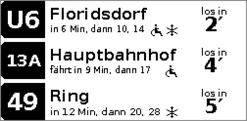
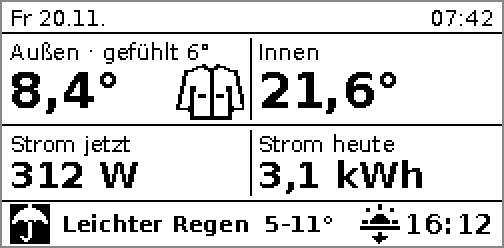

# Home Display

Ein kleines E-Paper-Display für zu Hause, zum Beispiel beim Eingang: Es zeigt die nächsten
Abfahrten der **Wiener Linien** („los in 4′“) und, wer **openHAB** hat, Werte aus dem
Smart Home (Temperaturen, Strom, Wetter, offene Fenster, Alarme). Es läuft auf einem
Raspberry Pi Zero W, wird im Browser eingerichtet und braucht keine App.




## Was es kann

- **Abfahrten der Wiener Linien** in Echtzeit, bis zu 9, mit Gehzeit zur Station:
  groß steht, wann man losgehen muss. Rollstuhl-Symbol bei barrierefreien Wagen,
  Schneeflocke bei klimatisierten, wenn es draußen heiß ist.
- **Mit openHAB** (optional): vier Messwert-Felder, Wetter mit Symbolen (Schirm,
  Sonnenbrille, Glatteis), Kleidungs-Tipp, offene Fenster, Waschmaschine,
  Vollbild-Alarme (Alarmanlage, Wasser, Rauch), Anwesenheit.
- **Sparsam:** zeichnet nur, wenn jemand da ist (Bewegungsmelder aus openHAB) oder
  nach Zeitplan, und wird weiß, wenn niemand hinschaut.
- **Einrichtung im Browser** unter `http://<pi>:8080`, mit Hilfe-Seite.
- **WLAN-Einrichtung ohne Tastatur:** Findet der Pi kein WLAN, öffnet er den Hotspot
  „Home Display“. QR-Code am Display scannen, die Einrichtung öffnet sich von selbst.
- Ohne openHAB läuft es als reine Abfahrtsanzeige.

## Hardware

| Teil | Hinweis |
| --- | --- |
| Raspberry Pi Zero W (oder neuer) | Raspberry Pi OS Bookworm (32 Bit, ohne Desktop) |
| Waveshare 2,13" E-Paper HAT **V4** | 250 × 122 Pixel, schwarz/weiß, SPI |
| Netzteil (USB) | |

## Installation

Auf dem Pi (Raspberry Pi OS mit WLAN und SSH eingerichtet):

```bash
git clone https://github.com/neppma/home-display.git
sh home-display/install.sh
sudo reboot
```

`install.sh` installiert die nötigen Pakete (`python3-pil`, `python3-spidev`,
`python3-lgpio`, `python3-qrcode`, …), schaltet SPI ein, kopiert das Programm nach
`~/openhab-display` und richtet den Dienst `openhab-display` ein. Eine vorhandene
`config.json` bleibt erhalten. Nach dem Neustart zeigt das Display eine Minute lang die
Adresse der Einstellungen (mit QR-Code).

Am Anfang ist openHAB ausgeschaltet und das Display aktualisiert nach Zeitplan. Abfahrten
trägt man im Reiter **Wiener Linien** ein (Linie → Station → Richtung).

## Mit openHAB

Im Reiter **Allgemein** „openHAB verwenden“ einschalten und die Adresse eintragen
(z. B. `http://openhab:8080`). Gelesen wird über REST und den Event-Stream, das Display
schaltet nichts in openHAB. Die Item-Namen in der Beispiel-Konfiguration sind
Platzhalter; im Reiter **openHAB-Display** wählt man die eigenen Items aus einer Liste.
Braucht openHAB eine Anmeldung, einen API-Token in `~/openhab-display/token` ablegen
(Rechte 600).

## Sicherheit

Die Web-Oberfläche hat keine Anmeldung und ist für das Heimnetz gedacht. Nicht ins
Internet freigeben.

## Lizenz

MIT, siehe [LICENSE](LICENSE). Enthält den Display-Treiber von Waveshare (MIT, leicht
geändert). Abfahrtsdaten: Wiener Linien, Open Government Data (CC BY 4.0). UV-Index und
Temperatur: [Open-Meteo.com](https://open-meteo.com) (CC BY 4.0, frei für nicht-kommerzielle
Nutzung).
